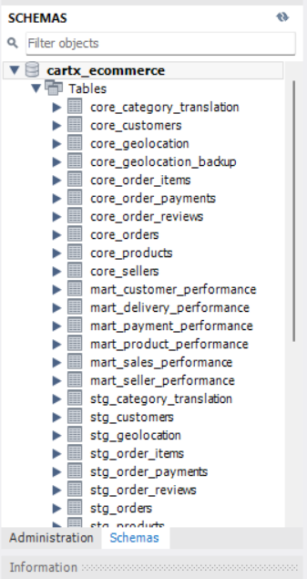
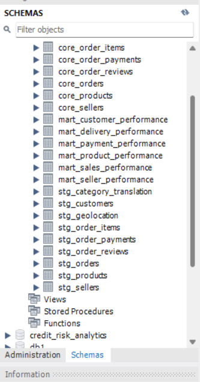
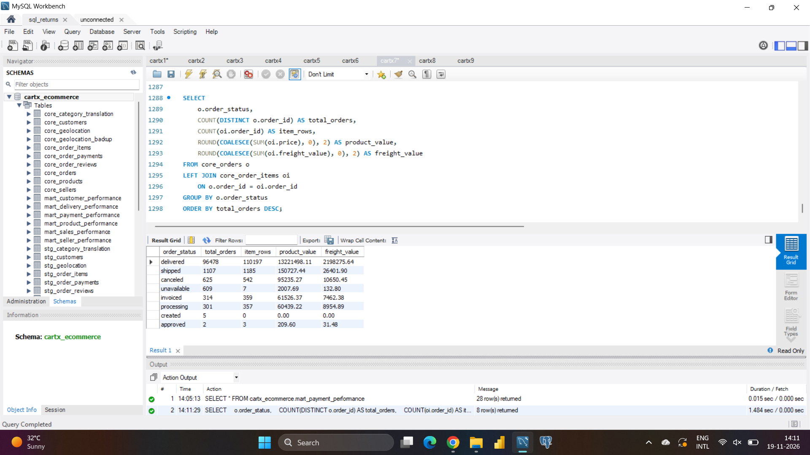
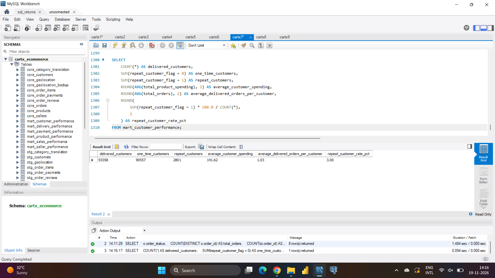
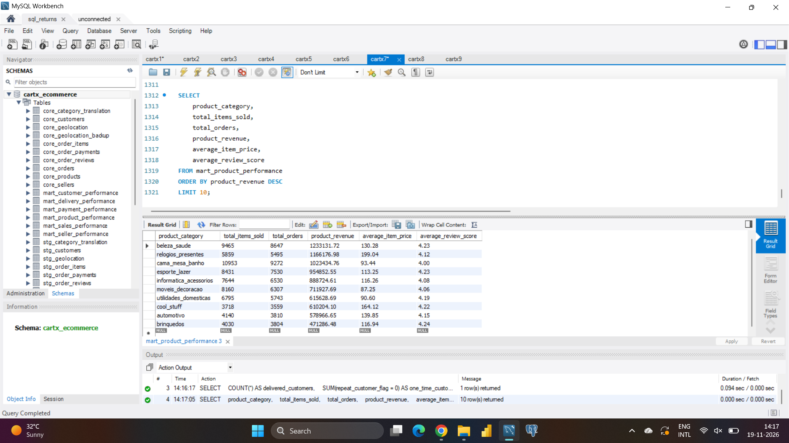
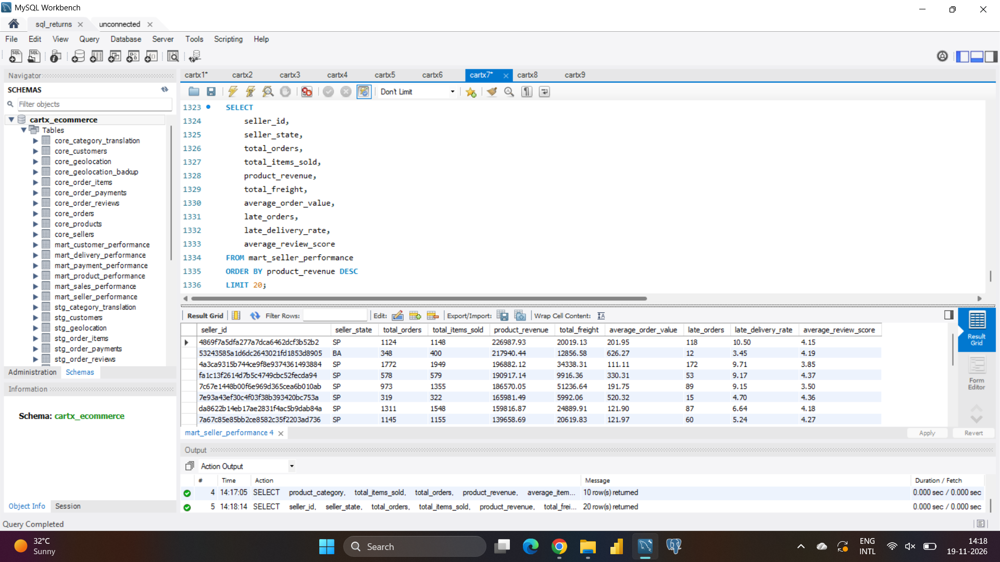
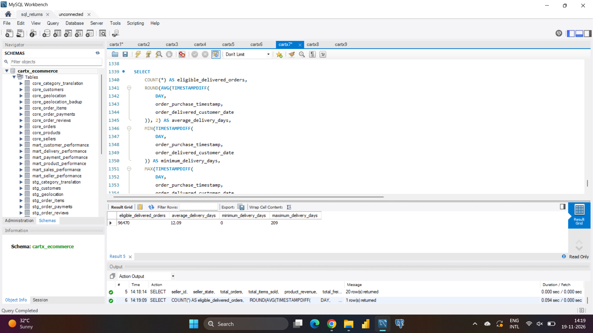
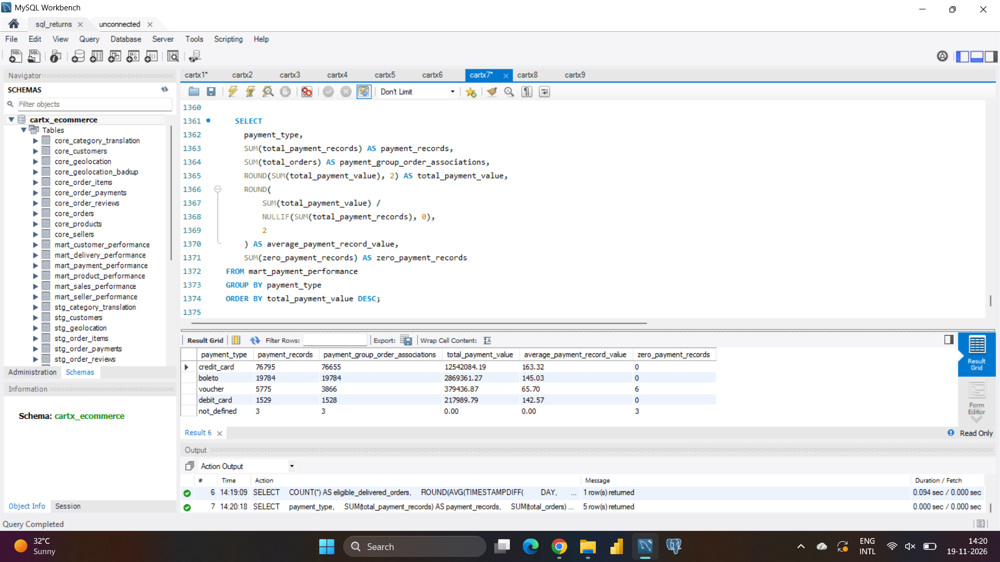

# CART-X — E-commerce Sales & Delivery Analytics

## Project overview

CART-X is a SQL-based data analytics project built using the Brazilian e-commerce dataset published by Olist. It transforms raw transactional data into structured, business-ready analytical tables and uses SQL to investigate sales, customers, products, sellers, payments, and delivery performance.

The project demonstrates an end-to-end SQL workflow: raw data loading, data cleaning, relational modeling, analytical table creation, business analysis, and validation.

## Business objective

The objective is to turn raw e-commerce records into reliable metrics that can help a business understand:

- How sales and order statuses change over time.
- How customer purchasing and repeat-purchase behavior vary.
- Which product categories contribute the most product revenue.
- How seller performance differs across sellers and states.
- Where and when delivery delays are more frequent.
- How customers use payment methods and installment plans.

This is an analytical decision-support project. It does not claim to calculate profit, prove causation, or represent a live production system.

## Dataset

**Source:** Olist Brazilian E-Commerce Public Dataset  
**Database:** `cartx_ecommerce`  
**SQL environment:** MySQL 8.0.46 / MySQL Workbench

The project uses nine source datasets:

| Source table | Description |
|---|---|
| customers | Customer and customer-location identifiers |
| orders | Order status and lifecycle timestamps |
| order_items | Products, sellers, prices, and freight per order item |
| order_payments | Payment type, installments, and payment values |
| order_reviews | Customer review scores and comments metadata |
| products | Product attributes and category identifiers |
| sellers | Seller identifiers and seller locations |
| geolocation | ZIP-code prefix and geographic coordinates |
| category_translation | Portuguese-to-English product category mapping |

The source data contains approximately 100,000 orders and more than one million raw geolocation records.

## Data architecture

The database is organized into three layers:

```text
STG (Staging)  →  CORE (Cleaned relational data)  →  MART (Analytical tables)
```

### 1. STG — Staging layer

Nine staging tables hold the imported source data. Source fields are initially stored in a permissive format to support CSV ingestion and reduce import failures caused by inconsistent source values.

### 2. CORE — Cleaned relational layer

The CORE layer contains nine active tables:

| Table | Rows | Purpose |
|---|---:|---|
| `core_customers` | 99,441 | Customer records |
| `core_orders` | 99,441 | Orders, converted timestamps, and data-quality flags |
| `core_sellers` | 3,095 | Seller records |
| `core_products` | 32,951 | Product attributes and quality flags |
| `core_order_items` | 112,650 | Products and sellers associated with orders |
| `core_order_payments` | 103,886 | Payment records |
| `core_order_reviews` | 99,224 | Order review records |
| `core_geolocation` | 720,496 | Exact-deduplicated geographic records |
| `core_category_translation` | 71 | Product category translations |

A separate `core_geolocation_backup` table preserves the original 1,000,163 geolocation rows before exact deduplication.

**Key modeling decisions:**

- Primary keys are applied to the active CORE tables.
- Foreign keys connect orders to customers, order items to orders/products/sellers, and payments/reviews to orders.
- Order timestamp strings are converted to `DATETIME`.
- Missing timestamp and chronology flags are retained for analysis rather than silently discarding affected records.
- Product quality fields help identify unknown categories and invalid or missing weight information.
- Geolocation exact duplicates are removed while the original source rows are preserved in the backup table.
- Repeated source `review_id` values are retained; an internal row identifier is used instead of assuming `review_id` is unique.

### 3. MART — Business-ready analytical layer

Six MART tables summarize the CORE data at defined levels of detail.

| MART table | Rows | Grain |
|---|---:|---|
| `mart_sales_performance` | 25 | One row per purchase month |
| `mart_customer_performance` | 93,358 | One row per delivered customer |
| `mart_product_performance` | 74 | One row per product category |
| `mart_seller_performance` | 2,970 | One row per seller with delivered sales |
| `mart_delivery_performance` | 556 | One row per purchase month and customer state |
| `mart_payment_performance` | 28 | One row per payment type and installment-count combination |

The grain is the meaning of one row in a table. Defining it before aggregation helps prevent accidental double counting.

## Data quality and transformation work

The project includes checks and handling for several source-data issues:

- **Geolocation duplicates:** 1,000,163 source rows were reduced to 720,496 after exact-row deduplication. The original table was retained as a backup.
- **Missing order timestamps:** Missing approval, carrier, and customer-delivery timestamps are identified with flags.
- **Timestamp chronology:** Potentially inconsistent order-event sequences are flagged for review.
- **Product attributes:** Unknown categories and missing or invalid weight values are identified.
- **Review identifiers:** Duplicate source review identifiers are not treated as unique primary keys.
- **Unavailable orders:** 603 unavailable orders have no order-item rows in the source data. These records are not assigned invented items.
- **Join multiplication:** Order items, payments, and reviews are aggregated at suitable grains before being combined in analytical queries, reducing the risk of inflated totals.

## Business analysis highlights

The SQL analysis investigates the following areas:

### Sales

- Delivered orders: **96,478**
- Delivered item rows: **110,197**
- Delivered product revenue: **R$13,221,498.11**
- Delivered freight value: **R$2,198,275.64**

Product revenue represents item prices and excludes freight. It is not profit.

### Customers

For the delivered-customer MART population:

- Customers: **93,358**
- One-time customers: **90,557**
- Repeat customers: **2,801**
- Average product spending per customer: **R$141.62**

The analysis also segments customers by spending and compares repeat-purchase rates across segments.

### Product categories

The highest product-revenue categories include:

1. `beleza_saude` — R$1,233,131.72
2. `relogios_presentes` — R$1,166,176.98
3. `cama_mesa_banho` — R$1,023,434.76
4. `esporte_lazer` — R$954,852.55
5. `informatica_acessorios` — R$888,724.61

Category revenue is based on delivered item prices and is not a measure of category profit.

### Delivery

For delivered orders with both purchase and actual delivery timestamps:

- Eligible orders: **96,470**
- Average delivery duration: **12.09 days**
- Late deliveries: **6,534**
- Late-delivery rate: **6.77%**

Late delivery is defined by comparing calendar dates: the actual customer-delivery date is later than the estimated delivery date. The analysis also examines monthly and state-level differences.

### Payments

Payment analysis compares payment types, installment counts, payment values, and zero-value payment records. Payment totals are descriptive source-record totals; they should not be interpreted as recognized sales revenue without a separate reconciliation and accounting definition.

## Important metric definitions and limitations

- **Product revenue:** Sum of item prices. Freight is reported separately. No product costs or operating expenses are available to calculate profit.
- **Delivered sales:** Sales analyses that describe delivered business performance filter to delivered orders unless stated otherwise.
- **Payment value:** Payment records may include orders with different statuses and multiple payment records per order. Payment value is not automatically equivalent to delivered revenue.
- **Late delivery:** `DATE(actual_delivery_timestamp) > DATE(estimated_delivery_timestamp)`. Comparing full timestamps would be misleading because the estimated timestamp is stored at midnight.
- **Delivery duration:** Calculated using whole-day date differences. A duration of zero means less than one complete day, not necessarily zero elapsed time.
- **Reviews:** Review scores are order-level feedback associated with products or sellers for analysis; they are not direct product or seller ratings.
- **Association vs. causation:** Relationships between delivery delays, review scores, seller location, and other metrics do not establish causal explanations.
- **Source-data limitations:** Some unavailable orders have payment records but no item rows. The project preserves and documents this inconsistency rather than inventing missing details.

## SQL concepts demonstrated

- Database and table creation
- CSV data loading
- Data type conversion and data cleaning
- Primary keys, composite keys, and foreign keys
- Joins and subqueries
- Common table expressions (CTEs)
- Aggregate functions and conditional aggregation
- `CASE` expressions
- Date and timestamp functions
- Window functions and ranking
- Deduplication and data-quality checks
- Analytical table design and grain definition
- Reconciliation and validation queries

## Project folder structure

```text
CART-X-Ecommerce-SQL-Analytics/
│
├── README.md
│
├── 01_Database_Setup.sql
├── 02_Staging_Tables.sql
├── 03_Data_Import.sql
├── 04_Core_Transformations.sql
├── 05_Mart_Creation.sql
├── 06_Business_Analysis.sql
├── 07_Final_Validation.sql
│
└── PROJECT_SCREENSHOTS/
    ├── 01_Database_Tables_Top.png
    ├── 02_Database_Tables_Bottom.png
    ├── 03_Monthly_Sales_Performance.png
    ├── 04_Customer_Performance.png
    ├── 05_Product_Category_Performance.png
    ├── 06_Seller_Performance.png
    ├── 07_Delivery_Performance.png
    └── 08_Payment_Performance.png
```

The repository contains the finalized SQL scripts in its root directory and the project screenshots in the `PROJECT_SCREENSHOTS` folder. The original exploratory SQL files are not included in this repository.

## Project screenshots

### Database structure





### Business analysis results

**Monthly Sales Performance**



**Customer Performance**



**Product Category Performance**



**Seller Performance**



**Delivery Performance**



**Payment Performance**



## Execution order

For a **fresh database rebuild**, use the clean scripts in this order:

1. `01_Database_Setup.sql`
2. `02_Staging_Tables.sql`
3. `03_Data_Import.sql`
4. `04_Core_Transformations.sql`
5. `05_Mart_Creation.sql`
6. `06_Business_Analysis.sql`
7. `07_Final_Validation.sql`

Before running `03_Data_Import.sql`, replace the placeholder CSV paths with the actual local file paths and confirm that local data loading is enabled in MySQL.

**Important:** These scripts are intended for a fresh rebuild. Do not run the CREATE/INSERT scripts against the already-populated project database: existing tables may cause conflicts or duplicate data. The import script must also not be rerun casually because it can append duplicate source rows. Review each script and back up any database before a rebuild.

## Project status

- Staging import and validation on the project database: completed
- CORE transformations and relational structure: completed
- MART table creation and reconciliation: completed
- Business analysis on the populated project database: completed
- Final validation on the populated project database: completed
- Repository documentation: completed

The clean scripts were organized from the development work. Their presence should not be taken as proof that a full rebuild has been independently tested in a separate fresh database.

## Author

**Raj Dinkar**  
Data Analytics / SQL Portfolio Project
